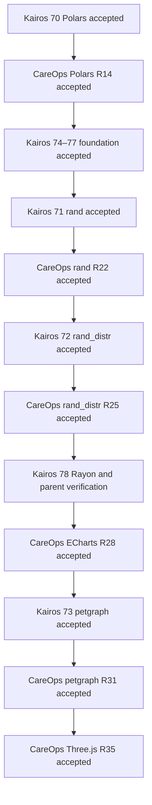

# Library adoption programme — 22 October 2026

Maturity: planning registered; no adoption implemented. Each direct library has a separate track, including rand and rand_distr. The paired records across repositories describe one library's upstream implementation and downstream adoption, not competing implementations.

## Existing adoption tracks

The complete serial order includes the foundation tracks and Rayon shown below.

| Order | Adoption | Local record | Ownership/handoff |
| --- | --- | --- | --- |
| 1 | rand deterministic RNG adoption | [Track](tracks/71-rand-deterministic-rng/index.md) | Kairos 71 → CareOps `rand_rng_adoption_20261022` |
| 2 | rand_distr statistical sampling adoption | [Track](tracks/72-rand-distr-sampling/index.md) | Kairos 72 → CareOps `rand_distr_sampling_20261022` |
| 3 | Apache ECharts analytical dashboard adoption | CareOps only; no upstream dependency | CareOps `echarts_dashboard_20261022` |
| 4 | petgraph spatial topology and routing adoption | [Track](tracks/73-petgraph-spatial-routing/index.md) | Kairos 73 → CareOps `petgraph_spatial_routing_20261022` |
| 5 | Three.js unified spatial viewer adoption | CareOps only; no upstream dependency | CareOps `threejs_spatial_viewer_20261022` |

Both Polars migrations must be accepted first. They preserve the existing RNG; subsequent rand and rand_distr changes each declare their own versioned trajectory break. ECharts is technically independent of routing/RNG, but follows them in this approved serial programme to prioritise maintenance reduction. No missing receipt is satisfied by a status label. External edges are explicit metadata/manual receipt gates; local task tools do not verify another repository. Accept upstream delivery before any downstream pin change. Routing waits for charts as a scheduling decision, not a Rust compile dependency.

## Architectural boundaries

Kairos owns generic stream assignment, deterministic RNG integration, generic sampling and spatial routing adapters. CareOps owns hospital configuration/profile mapping, analytical dashboard and browser renderer. Retain DES scheduler/resource machinery and domain hazard/clinical policy; no replacement track. Polars remains authoritative for applicable analytical transformations. DataFusion and WebGPU stay deferred without executable tracks. CAD capture/import is outside this adoption increment.

Use one Three.js viewer: orthographic parity first, perspective/multi-floor second. Preserve the existing renderer until usability, accessibility, performance and recovery are qualified, then remove it and unused PixiJS only where actually replaced. HTML controls/tables remain. Neither package declarations nor historical Done labels are runtime evidence.

## Shared acceptance contract

Capture baseline code, supported targets and representative workloads; pin and review exact dependency/features/licence/advisories and compatibility. Reconcile actual manifests, CI and parent pins before adoption: the historical Rust 1.76 planning floor is stale relative to Kairos Cargo.toml declaring 1.99; do not silently waive compatibility lanes. Independently test behaviour, failures/recovery and actual browser paths. Measure deleted/avoided bespoke production work alongside build/binary/bundle/memory/latency costs. Document retained exceptions and enforce baseline-derived budgets before replacement.

Every phase requires Conductor review/fixes and exact command, cwd, commit, toolchain, input/seed hashes, exit codes and artifacts. Local validation, hosted CI, integration and release remain distinct. No new library has been installed and no implementation checkbox is complete. The current active Polars entry gate remains unchanged.

This is repository engineering planning, not a maintained business document requiring SharePoint generation.

[Planning review and validation](library-adoption-review.md)

## Robustness-first refinement — 22 October 2026

The [robustness programme](robust-dependencies.md) and [value policy](dependency-value-policy.md) take precedence over the earlier direct Polars-to-rand-to-chart sequence: after both Polars receipts, complete Kairos 74–77 before rand; after both sampling receipts, complete Kairos 78 before ECharts. Existing RNG/sampling/routing/viewer contracts remain, with value gates. Optional FMI/network/solver/ECS/spatial work does not block this core sequence. SUMO is conditional; Rapier deferred without executable work.
