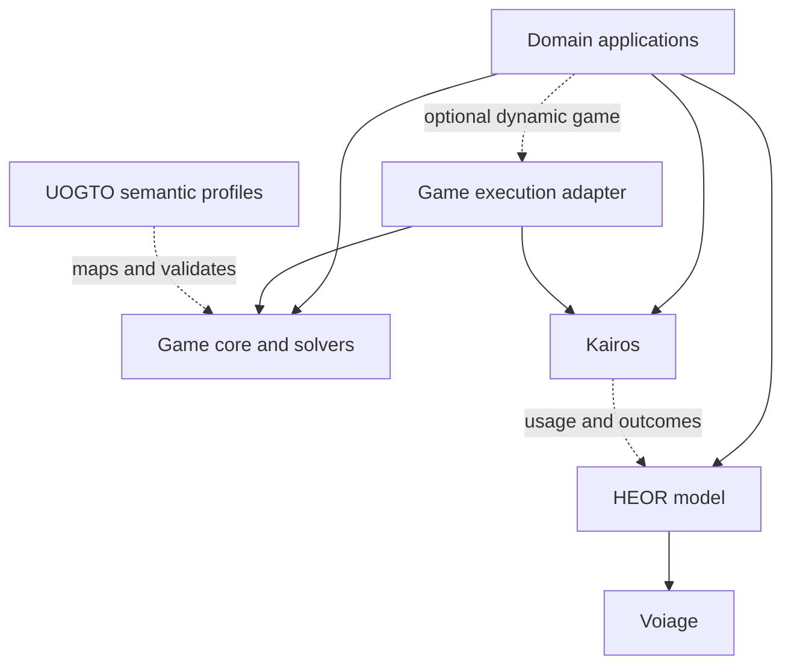

# Kairos and its ecosystem

Kairos is the Rust execution foundation for reproducible simulations. It should
be exceptionally good at a bounded job: executing a specified model with clear
time, state, resource, randomness and replay semantics. Scientific leadership
must be demonstrated on named workloads and methods; a larger feature list is
not evidence of it.

## Ownership

| Layer | Owns | Consumes |
| --- | --- | --- |
| Kairos | Time, events, state, identity, RNG, queues, allocation, replay; optional generic spatial and execution adapters | Maintained Rust infrastructure libraries |
| UOGTO | Game vocabulary, stable identifiers, executable-subset mappings, SHACL and semantic examples | Domain extension proposals |
| Rust game library | Game representations, solution concepts, solvers, residuals and traces | UOGTO mappings; optional Kairos execution adapter |
| CareOps Sim | Healthcare flow, patient/staff movement, service and transport policies, model calibration | Kairos; optional game and economic models |
| Innovate | Innovation/policy diffusion, adoption, competition, substitution, complements, hype effects, forecasts and innovation-specific games | Optional Kairos/game adapters; Voiage outcome exchange |
| Reimbursement game | Reimbursement institutions, particular strategic games and their economic assumptions | Generic game library, UOGTO, optional Kairos, Voiage and evidence providers |
| HEOR model/package | Resource valuation, health outcomes/utilities, perspectives, horizon, discounting and economic evaluation | Neutral usage/outcome records and reviewed data |
| Voiage | VOI estimators and decision uncertainty on paired strategy/draw outcomes | Domain-produced values and uncertainty contracts |

The HEOR package is a **proposed boundary**, not a newly released provider.
The game library already has an incubator: `uogto-game-core` and
`uogto-game-solve` in `new-drug-reimbursement-game`. Do not build a second generic
solver library before evaluating those crates.

The [extraction map](../conductor/contracts/game-extraction-map.md) now identifies
the actual source to reconcile. Pure representations/solvers move to the game
library; ECS storage and event execution meet it through a small optional
[execution port](../conductor/contracts/game-execution-port.md). The receiving
work is [issue 100](https://github.com/edithatogo/new-drug-reimbursement-game/issues/100)
and its existing T17 track. No new library name or repository is assumed here.

Arrows labelled with data describe interchange, not required Cargo dependencies.
The optional adapter imports game-core and Kairos; game-core itself does not
import the adapter. A static matrix game, closed-form diffusion calculation or
VOI analysis can therefore run without an event engine. Kairos's minimum crate
closure must not acquire game solvers, ontology tooling, Arrow, GPU, MPI, Python
or a domain application through accidental default features.

## Game contracts have three parts

UOGTO defines what a game, player, information set, strategy, action and outcome
mean. A versioned executable profile specifies the supported subset, data
types, numeric conventions and unsupported constructs. Domain packages define
the actual players, rules, information, utility/payoff assumptions and scenario
parameters. None of these replaces the solver's mathematical contract.

Preserve specification, instance, session, trace, strategy and action identities.
Keep payoffs distinct from observed outcomes and monetary costs. Support
finite/tolerance rules, tie policies, residuals, convergence and a truthful
unsupported result. Do not import all OWL reasoning into the simulation hot path.
Generate/validate mappings at input boundaries and carry stable identifiers into
traces. Domain-specific ontology extensions should use UOGTO's extension process
rather than incompatible local meanings for the same identifier.

A solver may inspect hypothetical alternatives without executing them. Its
diagnostic trace and expected payoff are different records from a simulated
causal trace and realized outcome. The dynamic adapter executes a chosen policy
with lawful observations, legal actions and an explicit chance process; it
preserves Kairos's clock/state/RNG ownership. Solver exploration has a separate
random-stream purpose so changing the search budget cannot perturb unrelated
model randomness.

## Movement, allocation and valuation

A patient moves between rooms; a porter is occupied for twelve minutes; a
health-economic model values the porter's time under a named perspective. These
are three connected records, with different semantics.

Kairos can provide route queries, checked simulation durations, scheduled
departure/arrival and cancellation, resource admission/release and replayable
usage records. CareOps decides which patient may travel, which porter is needed,
which corridors are accessible and how travel affects a clinical pathway. A
financial agent with a budget need not acquire coordinates or a movement system.

The neutral ledger records quantities and units, including occupied unit-ticks
and consumable quantities. The HEOR model maps those facts to values. It must
declare currency and price year, perspective, time origin and horizon, discount
functions, cost categories, utility interpretation and uncertainty. Keep fiscal
payments, revenue/transfers and economic resource/opportunity costs separate.
Prevent double counting, such as charging both an inclusive bed-day rate and its
already-included labour component. A budget constraint may influence a domain
decision, but its monetary semantics do not belong in Kairos's allocator.

Existing HEOML extension drafts in Innovate provide an interchange starting
point; they do not establish a released HEOR engine or numerical validity.

Do not impose one generic economic model on every use case. Cost-effectiveness,
budget impact, distributional analysis and reimbursement payoffs may consume
common records while applying different assumptions. Voiage receives paired
strategy/draw results with units and parameter provenance; it does not need to
rerun or own the simulation.

## What consumers need from Kairos

1. A minimal, documented public crate family; optional heavy features with
   measurable build and run cost.
2. Checked units/time, generational identities and explicit ownership/errors.
3. A coherent movement and resource-use lifecycle with cancellation, replay,
   topology changes and partial observation defined.
4. Installed examples that actually schedule events, mutate entity state and
   use Rust RNG; imports, printed symbols and DTO validation prove less.
5. Stable schemas and versioned snapshots/results, without every consumer
   needing Arrow or another repository's checkout.
6. A capability report and semantic/performance regression checks for dependency
   upgrades. No automatic pin bump from a green upstream unit suite.

The [dated consumer inventory](../conductor/ecosystem-consumers.md) distinguishes
direct source dependencies from data adapters and proposals. It is evidence
about inspected source, not a certification of every installed consumer.

## Delivery sequence and long-term goals

First repair scientific mislabelling and protect the small deterministic kernel.
Next qualify one minimal installed consumer, movement/usage contracts and a
CareOps adapter. In parallel, qualify the game incubator's package boundary and
Innovate's actual native dispatch. Add the HEOR worked example and paired Voiage
fixture only after their units and perspective are explicit.

Beta should have a small supported surface, completed numerical methods within
that surface, measured serial performance, working native packages and consumer
replay fixtures. Stable release adds the compatibility, upgrade, documentation
and reproducibility guarantees in the [release gates](../conductor/release-gates.md).
Experimental GPU/HPC or advanced game methods need not block a bounded core
release when excluded clearly, but their unfinished obligations remain tracked.

Treat core simulation, static game solving and dynamic game integration as
separate release scopes. CareOps/Innovate can qualify native runtime use without
waiting for their optional game profiles. Static game consumers can qualify
without a Kairos adapter. An adapter claim needs both accepted providers and
actual replay/identity/observation fixtures. The optional work stays open; it
does not become a hidden prerequisite for every consumer or release.

The long-term advantage is reliable composition: one simulation kernel, reusable
qualified analytical methods, domain assumptions visible in their own packages,
and automated replay/contract/performance checks. Pursue advanced backends and
novel algorithms only against falsifiable workloads and independent references.
See [ADR 0011](adr/0011-ecosystem-boundaries.md) and the
[executable maturity workpack](../conductor/execution/README.md).
