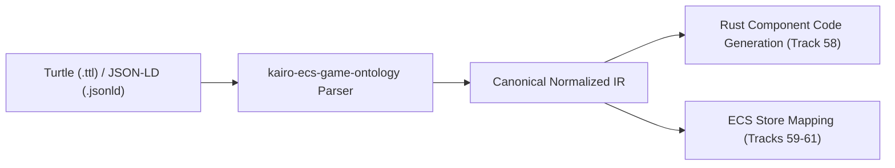

# Open Game Theory Ontology & Schema Ingestion

## Overview

KairoECS currently contains ontology fixtures/generated artefacts in
`open-game-theory-ontology/` and an ingestion parser in
`crates/kairo-ecs-game-ontology`. That directory is not a Git submodule or a
separately pinned ontology repository. The canonical semantic provider is
[UOGTO](https://github.com/edithatogo/UOGTO). The existing parser handles its
documented Turtle/JSON-LD subset; successful parsing does not validate every
ontology construct or establish solver correctness.

[ADR 0011](../adr/0011-ecosystem-boundaries.md) places reusable semantic mappings
and game solvers in the separate game-library layer, with an optional Kairos
execution adapter. Existing experimental crates remain labelled until their
Rust replacement and consumer compatibility are qualified. Specific games and
payoff assumptions remain in domain applications.

## Ingestion Architecture

The ingestion pipeline translates semantic schemas into a canonical, deterministic Intermediate Representation (IR):

### Supported Formats
1. **Turtle (`.ttl`)**: Ingests prefix mappings, classes (`rdfs:Class`), and properties (`rdf:Property`), tracking domain classes and range datatypes.
2. **JSON-LD (`.jsonld`)**: Ingests `@context` namespaces, `@graph` arrays, classes, and properties with strict alias normalization.

## Deterministic IR Normalization

To ensure exact reproducibility across platforms, the parser enforces:
- **Lexicographical Ordering**: Classes and properties are sorted by their fully-qualified URI and local identifier.
- **Namespace Validation**: Elements without a valid namespace prefix are rejected with typed parser errors.
- **Malformed Input Protection**: Circular context references, invalid escape sequences, and duplicate class IDs are rejected immediately.

## Verification

Ingestion contracts are verified by:
- `cargo test -p kairo-ecs-game-ontology`: Ingestion and normalization test suite.
- `node scripts/validation/validate-game-theory-evidence.mjs`: Manifest gate verifying ingestion against the wave schema.
