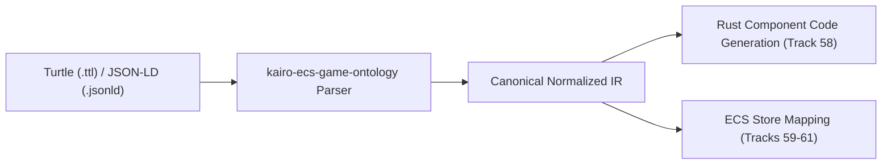

# Open Game Theory Ontology & Schema Ingestion

## Overview

KairoECS integrates with the Open Game Theory Ontology through a dedicated subrepository (`open-game-theory-ontology/`) and ingestion parser (`crates/kairo-ecs-game-ontology`). This enables deterministic serialization and ingestion of normal-form and extensive-form game descriptions formatted in standard semantic web formats (W3C Turtle `.ttl` and JSON-LD `.jsonld`).

## Ingestion Architecture

The ingestion pipeline translates semantic schemas into a canonical, deterministic Intermediate Representation (IR):

### Supported Formats
1. **Turtle (`.ttl`)**: Ingests prefix mappings, classes (`rdfs:Class`), and properties (`rdf:Property`), tracking domain classes and range datatypes.
2. **JSON-LD (`.jsonld`)**: Ingests `@context` namespaces, `@graph` arrays, classes, and properties with strict alias normalization.

## Deterministic IR Normalization

To ensure exact reproducibility across platforms, the parser enforces:
- **Lexicographical Ordering**: Classes and properties are sorted by their fully-qualified URI and local identifier.
- **Namespace Validation**: Elements without a valid namespace prefix are rejected with typed parser errors.
- **Malformed Input Protection**: Circular context references, invalid escape sequences, and duplicate class IDs are rejected immediately.

## Verification

Ingestion contracts are verified by:
- `cargo test -p kairo-ecs-game-ontology`: Ingestion and normalization test suite.
- `node scripts/validation/validate-game-theory-evidence.mjs`: Manifest gate verifying ingestion against the wave schema.
