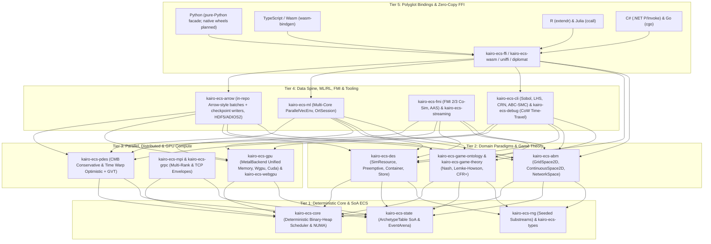

KairoECS is a Rust-native discrete-event (DES), agent-based (ABM), and game-theoretic simulation engine designed around **deterministic replay**, **Structure-of-Arrays (SoA) ECS storage**, **Apache Arrow zero-copy telemetry**, and **polyglot language bindings**.

---

## Five-Tier System Architecture

```text
+---------------------------------------------------------------------------------------------------+
| TIER 5: ZERO-COPY FFI & POLYGLOT LANGUAGE BINDINGS                                                |
|  +-----------------+ +-----------------+ +-----------------+ +-----------------+ +--------------+ |
|  | Python 3.10-3.14| | TypeScript/Wasm | | R (extendr)     | | Julia (ccall)   | | C# / Go      | |
|  | ctypes probe     | | wasm-bindgen    | | Arrow DataFrame | | Native C ABI    | | P/Invoke/cgo | |
|  +--------+--------+ +--------+--------+ +--------+--------+ +--------+--------+ +------+-------+ |
|           +-------------------+-------------------+-------------------+-----------------+         |
|                                                   |                                               |
|  +------------------------------------------------v---------------------------------------------+ |
|  | kairo-ecs-ffi (Stable C ABI / include/kairo_ecs.h) | kairo-ecs-uniffi | kairo-ecs-diplomat   | |
|  +------------------------------------------------+---------------------------------------------+ |
+---------------------------------------------------|-----------------------------------------------+
                                                    v
+---------------------------------------------------------------------------------------------------+
| TIER 4: DATA SPINE, ML/RL SURROGATES, CO-SIMULATION & OBSERVABILITY                               |
|  +--------------------------+ +--------------------------+ +------------------------------------+ |
|  | kairo-ecs-arrow          | | kairo-ecs-ml             | | kairo-ecs-fmi & kairo-ecs-streaming| |
|  | Arrow-style RecordBatch    | | ParallelVecEnv (OS-thread| | FMI 2.0/3.0 Co-Sim Master (.fmu)   | |
|  | custom checkpoint format     | | batch step) + OrtSession | | AAS Digital Twin + Kafka/Flight    | |
|  +--------------------------+ +--------------------------+ +------------------------------------+ |
|  +--------------------------+ +--------------------------+ +------------------------------------+ |
|  | kairo-ecs-cli            | | kairo-ecs-debug          | | kairo-ecs-viz & kairo-ecs-bench    | |
|  | ParallelEnsembleRunner   | | CowWorldSnapshot (CoW)   | | WebGPU / Headless Snapshot &       | |
|  | Sobol / LHS / ABC-SMC    | | Time-Travel & Breakpoints| | Reproducible Benchmark Harnesses   | |
|  +--------------------------+ +--------------------------+ +------------------------------------+ |
+---------------------------------------------------|-----------------------------------------------+
                                                    v
+---------------------------------------------------------------------------------------------------+
| TIER 3: PARALLEL, DISTRIBUTED & GPU COMPUTE ENGINES                                               |
|  +--------------------------+ +--------------------------+ +------------------------------------+ |
|  | kairo-ecs-pdes           | | kairo-ecs-mpi & grpc     | | kairo-ecs-gpu & kairo-ecs-webgpu   | |
|  | Conservative Lookahead   | | MpiProcessTransport      | | PersistentGpuSession + MetalBackend| |
|  | Time Warp Rollback + GVT | | GrpcSocketTransport      | | (Apple Silicon Unified Memory)/WGSL| |
|  +--------------------------+ +--------------------------+ +------------------------------------+ |
+---------------------------------------------------|-----------------------------------------------+
                                                    v
+---------------------------------------------------------------------------------------------------+
| TIER 2: SIMULATION PARADIGMS & MULTI-GAME SOLVERS                                                 |
|  +--------------------------+ +--------------------------+ +------------------------------------+ |
|  | kairo-ecs-des            | | kairo-ecs-abm            | | kairo-ecs-game-ontology & theory   | |
|  | SimResource / Priority / | | GridSpace2D (Moore/VN)   | | Turtle/JSON-LD -> Rust Codegen     | |
|  | Preemptive / Container / | | ContinuousSpace2D Hash   | | Normal-Form (Pure/Lemke-Howson)    | |
|  | Store / Reneging         | | NetworkSpace (CSR Graph) | | Extensive-Form (Backward Ind./CFR+)| |
|  +--------------------------+ +--------------------------+ +------------------------------------+ |
+---------------------------------------------------|-----------------------------------------------+
                                                    v
+---------------------------------------------------------------------------------------------------+
| TIER 1: DETERMINISTIC FOUNDATION & STRUCTURE-OF-ARRAYS (SoA) ECS CORE                             |
|  +--------------------------+ +--------------------------+ +------------------------------------+ |
|  | kairo-ecs-types          | | kairo-ecs-core           | | kairo-ecs-state & kairo-ecs-rng    | |
|  | SimTime (u64 ns)         | | Deterministic Scheduler  | | ArchetypeTable (Dense SoA Columns) | |
|  | EntityId / EventId       | | (timestamp, prio, seq)   | | EventArena + SplitMix64 Substreams | |
|  | ScheduleKey              | | NUMA Topology Discovery  | | Common Random Numbers (CRN)        | |
|  +--------------------------+ +--------------------------+ +------------------------------------+ |
+---------------------------------------------------------------------------------------------------+
```



---

## Complete Workspace Crate Inventory (23 Crates)

| Crate | Tier | Key Types & Capabilities | Feature Flags | Track Ownership |
| :--- | :--- | :--- | :--- | :--- |
| `kairo-ecs-types` | Tier 1: Core | `SimTime`, `EntityId`, `EventId`, `Priority`, `ScheduleKey` total-order keys | `default` | Track 00 / 01 |
| `kairo-ecs-core` | Tier 1: Core | Deterministic `Scheduler`, cancellation handles, `NumaTopology`, core affinity | `numa` | Track 01 / 50 |
| `kairo-ecs-state` | Tier 1: Core | `World`, `ArchetypeTable` dense SoA columns, `ComponentStore`, `EventArena` | `numa` | Track 01 / 50 / 64 |
| `kairo-ecs-rng` | Tier 1: Core | Deterministic `RngStream`, per-entity substream derivation, replay verification | `default` | Track 01 |
| `kairo-ecs-des` | Tier 2: Paradigms | `SimResource`, `PriorityResource`, `PreemptiveResource`, `Container`, `Store` | `default` | Track 03 / 64 |
| `kairo-ecs-abm` | Tier 2: Paradigms | `GridSpace2D` (Moore/VN, torus), `ContinuousSpace2D`, `NetworkSpace` (CSR) | `default` | Track 03 / 64 |
| `kairo-ecs-game-ontology` | Tier 2: Paradigms | `parse_turtle`, `parse_jsonld`, `normalize_ontology`, deterministic Rust codegen | `codegen` | Track 57 / 58 |
| `kairo-ecs-game-theory` | Tier 2: Paradigms | `PayoffMatrix`, `PureNashSolver`, `LemkeHowsonSolver`, `BackwardInductionSolver`, `CfrPlusSolver`, `ChildOf`/`TransitionTo` | `generated-components`, `graph-relations` | Track 58–61 / 65 |
| `kairo-ecs-pdes` | Tier 3: Scale | Conservative lookahead LP runtime, Jefferson Time Warp rollback, antimessages, Mattern GVT | `pdes`, `time-warp` | Track 34 / 47 / 48 |
| `kairo-ecs-mpi` | Tier 3: Scale | `MpiProcessTransport`, multi-rank `mpiexec` coordinator, all-reduce GVT | `mpi` | Track 35 / 49 |
| `kairo-ecs-grpc` | Tier 3: Scale | `GrpcSocketTransport`, `KairoOptimisticEnvelopeV1` length-delimited TCP framing | `grpc` | Track 35 / 49 |
| `kairo-ecs-gpu` | Tier 3: Scale | `PersistentGpuSession`, `MetalBackend` (Apple Silicon unified memory + multi-core workgroups), `WgpuBackend`, `CudaBackend` | `gpu`, `metal-backend`, `wgpu-backend`, `cuda-backend` | Track 32 / 52 |
| `kairo-ecs-webgpu` | Tier 3: Scale | Browser WGSL compute shader pipeline, staging ring buffers, CPU parity checks | `webgpu` | Track 33 / 52 |
| `kairo-ecs-arrow` | Tier 4: Data & I/O | Arrow-compatible in-repo `ArrowRecordBatch` and checkpoint writers (custom byte format, not yet the official `arrow`/`parquet` crates), HDF5/ADIOS2 checkpoints | `parallel-io`, `hdf5`, `adios2` | Track 04 / 51 / 62 |
| `kairo-ecs-ml` | Tier 4: AI / RL | `ParallelVecEnv` (multi-threaded OS thread pool via `std::thread::scope`), `OrtSession`, `InferenceTickHook` | `onnx`, `tensorrt`, `burn`, `gymnasium` | Track 37 / 65 |
| `kairo-ecs-fmi` | Tier 4: Digital Twin | `FmuArchive`, `Fmi2CoSimInstance`, `Fmi3CoSimInstance`, `DynamicFmuLoader`, AAS submodel validation | `fmi-runtime`, `fmi2`, `fmi3` | Track 38 / 53 |
| `kairo-ecs-streaming` | Tier 4: Streaming | Real-time wallclock pacer, Kafka event sink/source contract, Arrow Flight batch stream | `kafka`, `arrow-flight` | Track 36 |
| `kairo-ecs-debug` | Tier 4: Debugging | `CowWorldSnapshot` (copy-on-write delta pages), time-travel forward/backward stepper, breakpoints | `default` | Track 40 / 66 |
| `kairo-ecs-viz` | Tier 4: Visuals | Headless frame snapshot exporter, entity trajectory and resource queue summaries | `default` | Track 05 |
| `kairo-ecs-cli` | Tier 4: Experiments | Scenario runner, `ParallelEnsembleRunner`, `SobolSensitivityAnalyzer`, `LatinHypercubeSampler`, `AbcSmcCalibrator` | `default` | Track 22 / 66 |
| `kairo-ecs-bench` | Tier 4: Benchmarks | Deterministic throughput harnesses (1M DES events, 100k hybrid DES+ABM, SoA SIMD sweep) | `default` | Track 12 / 18 / 31 |
| `kairo-ecs-ffi` | Tier 5: Bridges | `extern "C"` C ABI (`kairo_ecs.h`), scheduler/state handles, `kairo_ecs_export_arrow_c_data` | `numa` | Track 02 / 62 / 63 |
| `kairo-ecs-wasm` | Tier 5: Bridges | `WasmSimulation` (`wasm-bindgen` typed arrays) and `WasmTimeTravelInspector` | `default` | Track 09 / 63 / 66 |
| `kairo-ecs-uniffi` | Tier 5: Bridges | UniFFI cross-language record and handle bridge anchored to `kairo-ecs-ffi` | `default` | Track 02 |
| `kairo-ecs-diplomat` | Tier 5: Bridges | Diplomat FFI definition surface for structured multi-language code generation | `default` | Track 02 |

---

## Polyglot Language Binding Architecture

| Language | Package / Directory | Bridge Mechanism | Zero-Copy / Data Exchange | Key Capabilities |
| :--- | :--- | :--- | :--- | :--- |
| **Rust** | `crates/*` | Native workspace crates | Direct `ArchetypeTable` slices & `arrow_array::RecordBatch` | Full access to all 23 crates, compile-time type safety, `#![forbid(unsafe_code)]` in domain crates |
| **Python (3.10–3.14)** | `bindings/python/` | pure-Python facade (ctypes probe; PyO3 planned) | Arrow-style export (C Data Interface not yet wired) | `Scheduler`, `PettingZooParallelEnv`, `GymnasiumVecEnv` (`kairo_gym`), deterministic replay |
| **TypeScript / Wasm** | `bindings/typescript/` + `crates/kairo-ecs-wasm` | `wasm-bindgen` & WebAssembly linear memory | TypedArray (`Float64Array`, `Int64Array`) views + Arrow IPC bytes | Browser & Node.js `WasmSimulation`, `WasmTimeTravelInspector`, interactive studio |
| **R** | `bindings/r/` | `extendr` / `.Call` C ABI | Arrow table / R `data.frame` batch conversion | Deterministic event scheduling, parameter sweeps, statistical output analysis |
| **Julia** | `bindings/julia/` | Native `ccall` into `libkairo_ecs_ffi` | `Arrow.Table` zero-copy buffer handoff | High-frequency stepping, scientific computing & DifferentialEquations.jl co-simulation |
| **C# (.NET 10/11)** | `bindings/csharp/` | `DllImport` / `LibraryImport` P/Invoke | Span-based struct marshaling & Arrow stream export | Enterprise digital-twin integration, strongly typed `SimulationScheduler` |
| **Go** | `bindings/go/` | `cgo` over `include/kairo_ecs.h` (plus pure-Go contract mode) | Flat buffer slices & gRPC distributed worker integration | Cloud-native microservice orchestration & batch worker control |

---

## Execution & Data-Flow Walkthrough

1. **Initialization & Seed Derivation (`kairo-ecs-core`, `kairo-ecs-rng`):**
   A simulation run starts with a 64-bit master seed. `CommonRandomNumbersPlan` derives independent, collision-free substream seeds for each `(run_id, entity_id)` pair so baseline and counterfactual policy runs share identical stochastic shocks.
2. **SoA State & Domain Stepping (`kairo-ecs-state`, `kairo-ecs-des`, `kairo-ecs-abm`, `kairo-ecs-game-theory`):**
   Entities reside in dense `ArchetypeTable` columns (`Vec<T>` per component type). DES events execute in strict `(SimTime, Priority, EventId)` order across `SimResource` / `PreemptiveResource` queues, while ABM agents query spatial neighbors through `GridSpace2D` or `ContinuousSpace2D` and resolve strategic interactions via `PureNashSolver`, `LemkeHowsonSolver`, or `CfrPlusSolver`.
3. **Multi-Core & GPU Acceleration (`kairo-ecs-ml`, `kairo-ecs-cli`, `kairo-ecs-gpu`):**
   - For reinforcement learning and sensitivity sweeps, `ParallelVecEnv::step_batch` and `ParallelEnsembleRunner::run_sweep` partition worlds across OS worker threads using safe `std::thread::scope`.
   - For particle/event acceleration on macOS, `MetalBackend` (feature `metal-backend`) pairs Apple Silicon unified-memory residency (`PersistentGpuSession`) with multi-threaded workgroup execution that is bit-for-bit identical to `CpuFallbackCompute`.
4. **Zero-Copy Telemetry & Checkpointing (`kairo-ecs-arrow`, `kairo-ecs-debug`):**
   Completed ticks stream into Apache Arrow `RecordBatch` columns, serialize to Zstd-compressed Parquet files or HDF5/ADIOS2 checkpoint envelopes, or cross the C ABI boundary via `kairo_ecs_export_arrow_c_data` directly into Python (`pyarrow`, Polars, DuckDB) without copying memory.

---

## Governance & Evidence Posture

| Wave / Capability | Tracks | Status | Verification Surface |
| :--- | :--- | :--- | :--- |
| **Foundation, Core Engine & Polyglot Bindings** | Tracks `00–17` | **Done (18/18)** | Rust workspace CI, conformance fixtures, 6 language binding smoke suites |
| **Benchmarks, VVUQ, Governance & Toolchains** | Tracks `18–31` | **Done (14/14)** | Reproducibility checks, OpenSSF supply-chain gates, API compatibility pack |
| **Advanced Compute Scaffolds (GPU, PDES, ML, FMI, Debug)** | Tracks `32–45` | **Done (14/14)** | Unit/integration suites, Starlight docs SOTA gate, code health >= 9.5/10 |
| **Game Theory Ontology & Multi-Game Solvers** | Tracks `56–61` | **Done (6/6)** | Turtle/JSON-LD ingestion, deterministic codegen, Graph-ECS, normal/extensive solvers |
| **Production Spine, Native Wheels, SoA/DES/ABM, MARL & SBI** | Tracks `62–66` | **Done (5/5)** | in-repo Arrow-style columnar format (official `arrow`/`parquet` crate adoption planned), C Data FFI, SimPy-parity resources, Lemke-Howson/CFR+, Sobol/ABC-SMC |
| **HPC Parity Charter, Conservative PDES & Cloud Gate** | Tracks `46, 47, 54` | **Done (3/3)** | Conservative lookahead PDES runtime, HPC evidence schema & container/scheduler gates |
| **Multi-Node Cluster / Lustre / Native CUDA Hardware Certification** | Tracks `48–53, 55` | **In Progress (7/7)** | Local Rust/macOS Metal/multi-rank MPI/socket/checkpoint code is merged & tested; final `live-hpc` promotion awaits external multi-node cluster hardware |

## Known gaps and substitution candidates

| Area | Current state | Maintained alternative |
| --- | --- | --- |
| `kairo-ecs-arrow` | Custom Arrow-style and checkpoint byte formats; checksum is not SHA-256 | `arrow`, `parquet`, `sha2` |
| `kairo-ecs-ml` | `OrtSession::run` echoes input; no ONNX Runtime | `ort`, `burn` |
| `kairo-ecs-streaming` | Kafka/NATS/WebSocket/Flight features alias an in-memory stream | `rdkafka`, `async-nats`, `arrow-flight` |
| `kairo-ecs-game-ontology` | Line/byte matching parser for Turtle and JSON-LD | `oxttl`, `oxrdf`, `json-ld` |
| `kairo-ecs-mpi` / `kairo-ecs-grpc` | Empty marker features; hand-rolled sockets | `mpi` (rsmpi), `tonic`, `prost` |
| Python / Wasm bindings | Python never loads the native library; Wasm snapshot values are placeholders | PyO3 + maturin, `wasm-bindgen` |
| `kairo-ecs-viz` | `wgpu`/`bevy` renderers not wired | `wgpu`, `bevy` |
